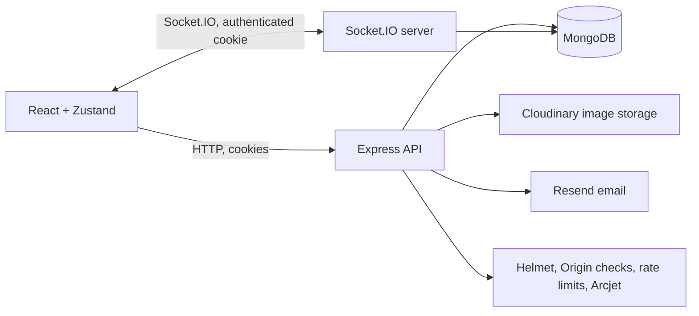

# mingle.

Mingle is a real-time one-to-one chat app built with React, Express, MongoDB, and Socket.IO. It includes password-based accounts, private DMs, presence, image sharing, and a responsive dark/light interface.

## Stack

| Area            | Technology                                                                    |
| --------------- | ----------------------------------------------------------------------------- |
| Frontend        | React 19, Vite, Zustand, Axios, Tailwind CSS, DaisyUI                         |
| API             | Node.js, Express 4, Zod                                                       |
| Realtime        | Socket.IO client and server                                                   |
| Database        | MongoDB, Mongoose                                                             |
| Authentication  | bcryptjs, signed HTTP-only JWT cookies, rotating refresh sessions             |
| Media and email | Cloudinary, Resend                                                            |
| Security        | Helmet, exact-origin CORS/Origin checks, Express rate limits, optional Arcjet |
| Code quality    | ESLint, Prettier, Node.js test runner                                         |

## Architecture



## Current product scope

Implemented:

- Signup/login/logout, bcrypt password hashing, short-lived access cookies, rotating refresh cookies, and Mongo-backed sessions.
- Production email verification (enabled by default in production), verification resend, password-reset links, and session revocation after password reset.
- One-to-one DMs, live messages, typing state, presence/last seen, unread counts, read and delivery timestamps, and an in-memory offline send queue with idempotency IDs.
- Cursor-based message history, indexed message-search API, image compression and Cloudinary upload, edit/delete, replies, emoji reactions, and pinning.
- Block/report API endpoints, safe contact projections, request schemas, upload limits, security headers, rate limiting, and a database-aware health endpoint.
- Responsive full-screen mingle landing/auth/chat pages, a cinematic dark default with a saved light/dark toggle, reduced-motion support, and keyboard shortcuts.
- Cinematic landing page with a lightweight CSS conversation animation, staggered message arrivals, a typing indicator, and reduced-motion support. No WebGL or external 3D assets are required for the homepage.
- Message-history search in the inbox, contact mute controls, browser alerts (after permission), sound alerts, and block/report controls with a blocked-people list.
- Blocked conversations are excluded from contact lists, history, search, and message actions.

Still to build: group conversations and public channels; admin/member management; service-worker push notifications; voice notes and generic file uploads; upload progress; link previews; Google OAuth; Redis-backed multi-instance presence/pub/sub; and broader browser E2E coverage. Message-search results open the matching DM; jumping directly to the matched message is not implemented yet. The offline queue is in memory for the current tab and does not survive a reload. Mingle does not provide end-to-end encryption.

## Project layout

```text
backend/src/
  controllers/    Auth and message request handlers
  Emails/         Verification, recovery, and welcome email templates
  lib/            Environment, validation, security, and provider setup
  middleware/     Auth and optional Arcjet checks
  models/         MongoDB users, messages, sessions, and reports
  routes/         REST route definitions
  scripts/        Database index setup
  server.js       Express API and authenticated Socket.IO server
backend/test/     Validation and opt-in local integration tests
frontend/src/
  components/     Shared UI
  lib/            Axios API client
  pages/          Landing, auth, recovery, and chat screens
  store/          Zustand auth and chat state
```

## Local development

Requirements: Node.js 22+, npm, and Docker (or a local MongoDB). Cloudinary, Resend, and Arcjet credentials are optional for local use; they are needed for their corresponding provider features.

1. Install dependencies:

   ```bash
   npm install --prefix backend
   npm install --prefix frontend
   ```

2. Copy `backend/.env.example` to `backend/.env.development` and replace the placeholder `JWT_SECRET` with a random value. Local development reads only `.env.development`; it never loads the production `.env` file. The local config uses a separate Mongo database and `EMAIL_VERIFICATION_REQUIRED=false` so you can create accounts without email credentials.

3. Start the isolated local MongoDB service:

   ```bash
   docker compose -f docker-compose.dev.yml up -d mongo-dev
   ```

4. Start the API:

   ```bash
   npm run dev --prefix backend
   ```

5. Start Vite in another terminal:

   ```bash
   npm run dev --prefix frontend
   ```

6. Open [http://localhost:5173](http://localhost:5173). Create two accounts in separate browser profiles to try real-time messaging.

For a separate frontend origin, set `CLIENT_URL` to the exact frontend origin. In production, use HTTPS and set `COOKIE_SAME_SITE=none` when the frontend and API are on different sites. The API checks the `Origin` header for state-changing requests.

## Tests and quality checks

```bash
npm test
npm run lint
npm run format:check
npm run build --prefix frontend
```

The backend unit tests cover input validation. The opt-in integration test checks signup/login, refresh rotation, authenticated Socket.IO messaging, delivery/read receipts, and message actions against a running local server:

```bash
MINGLE_INTEGRATION_URL=http://localhost:3000 npm run test:integration --prefix backend
```

Run it only with a local server connected to an isolated test database; it creates test accounts and messages. Browser E2E tests are still needed before treating the full product as production-ready.

## Docker

Copy and configure `backend/.env`, then run:

```bash
docker compose up --build
```

The compose stack starts MongoDB and the production Express app, which also serves the built frontend. Persist the `mingle-mongo` volume and back it up. Do not publish the MongoDB port publicly. The app requires a production `JWT_SECRET` of at least 32 characters. Set `EMAIL_VERIFICATION_REQUIRED=true` with valid `RESEND_API_KEY` and `EMAIL_FROM` values, or explicitly set it to `false` only if you accept unverified accounts.

## Deployment

### Single service / VPS / Railway

Build and run the root Dockerfile. Set `MONGO_URI`, `JWT_SECRET`, `CLIENT_URL`, `COOKIE_SAME_SITE`, `EMAIL_VERIFICATION_REQUIRED`, and provider credentials in the platform’s secret manager. Keep a persistent MongoDB volume or use managed MongoDB. Put TLS in front of the service and allow WebSocket upgrades for `/socket.io/`.

### Vercel frontend + Render API

- Deploy `frontend` as the Vercel project and set `VITE_API_URL=https://<api-host>/api`.
- Deploy the backend from the root Dockerfile on Render; set `CLIENT_URL` to the exact Vercel origin and use HTTPS.
- Set `COOKIE_SAME_SITE=none`, `JWT_SECRET`, MongoDB credentials, `RESEND_API_KEY`, `EMAIL_FROM`, and Cloudinary credentials on Render.
- Confirm the platform forwards WebSocket upgrades and that `/api/health` returns HTTP 200 after MongoDB connects.

The Express API currently requires a single active server for accurate presence. Use a Socket.IO Redis adapter plus shared presence storage before scaling the API horizontally.

## API map

- `POST /api/auth/signup`, `/login`, `/logout`, `/refresh`
- `POST /api/auth/verify-email`, `/resend-verification`, `/forgot-password`, `/reset-password`
- `GET /api/messages/contacts`, `/chats`, `/search?q=...`, `/:userId`
- `POST /api/messages/send/:userId`
- `PATCH /api/messages/:messageId`, `DELETE /api/messages/:messageId`
- `POST /api/messages/:messageId/reactions`, `/:messageId/pin`
- `POST /api/messages/contacts/:userId/block`, `/:userId/report`
- `GET /api/health`
